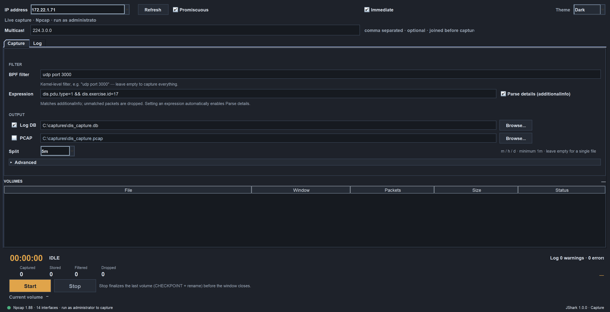
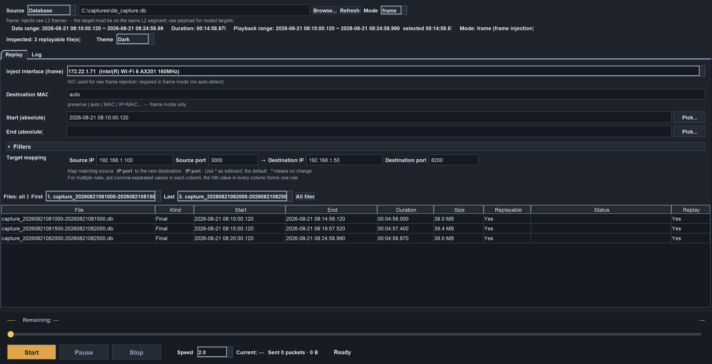
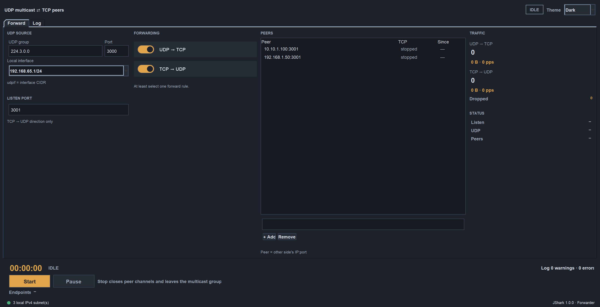

# JShark - Java通用网络抓包工具

JShark是一个使用Java开发的跨平台命令行网络包捕获和重放工具。它是一个通用的网络抓包工具，可以捕获和分析各种网络协议流量。

**注意**：虽然JShark可以捕获所有网络流量，但报文的详细解释和高级分析功能目前仅支持以下协议：
- **DIS协议**（分布式交互仿真协议）
- **HTTP协议**（超文本传输协议）
- **PG协议**（POSTGRES通讯协议）

对于其他协议（如TCP、UDP、ICMP等），JShark提供基本的协议识别和原始数据展示。

## 功能特性

- **实时包捕获**：基于 pcap4j 的跨平台抓包（Windows 需 Npcap/WinPcap，Linux/macOS 需 libpcap）
- **离线包读取**：用 `--pcapinput` 直接读 PCAP 文件，走与在线抓包**完全相同**的解析与入库流程
- **BPF过滤器**：支持标准的Berkeley Packet Filter表达式
- **多输出格式**：支持PCAP文件输出、数据库存储、控制台显示
- **数据库集成**：使用DuckDB存储捕获的包数据，支持高效查询
- **原样重放**：按帧逐字节注入，保留原始源 IP/端口/序列号/TTL/分片，只改写目标地址/端口与校验和
- **通用协议支持**：支持TCP、UDP、ICMP等常见网络协议的捕获和基本解析
- **高级协议解析**：提供详细的报文解释，目前支持：
  - **DIS协议**： 分布式交互仿真协议解析，支持所有PDU类型
  - **HTTP协议**：超文本传输协议解析，支持请求/响应分析
  - **PG协议**：  PostgreSQL数据库通讯协议解析，支持请求/响应分析
- **高级过滤**：支持基于包内容的表达式过滤
  - 针对DIS提供字段级过滤
  - 针对HTTP提供字段级过滤
  - 针对PG提供字段级过滤
  - 可选择如何处理"不匹配"的包（丢弃或保留并打标记），便于核对过滤条件是否写对
- **自动文件轮转**：支持按时间尺度（`--split`）自动分卷，同时作用于PCAP与logdb文件，文件名自动追加时间戳
- **后台运行与日志落盘**：采集与重放都支持 `--daemon` 转后台、`--logfile` 把日志写进文件，关掉控制台也不影响采集
- **采集图形界面**：`--ui` 提供与重放端同风格的采集控制台（子进程采集、实时计数、分卷表），见「[图形界面](#图形界面--ui)」

## 系统要求

- Java 21 或更高版本
- 网络抓包库：
  - Windows: Npcap 或 WinPcap
  - Linux/macOS: libpcap
- 适当的权限（管理员/root权限进行网络捕获）

## 快速开始

### 1. 安装依赖

#### Windows
1. 下载并安装 Npcap
```bash
npcap-1.87.exe /winpcap_mode=yes
```

#### Linux (基于RPM)
```bash
sudo yum install libpcap-devel
```

### 2. 构建项目

```bash
# 克隆项目
git clone <repository-url>
cd jshark

# 编译项目
mvn clean compile

# 打包可执行JAR
mvn package
```

构建完成后，会在`target`目录生成三个可执行JAR文件：
- `jshark-1.0.0-capture.jar` - 包捕获工具
- `jshark-1.0.0-replay.jar` - 包重放工具
- `jshark-1.0.0-udpforwarder.jar` - UDP/TCP 转发器

## 使用指南

### CliShark - 包捕获工具

#### 基本用法

```bash
java -jar target/jshark-1.0.0-capture.jar --ip_address=192.168.1.100 --filter="tcp port 80" --count=100
```

#### 命令行选项

| 选项                      | 参数                | 说明                                                                                                                                                                     | 默认值       | 示例                                                   |
|-------------------------|-------------------|------------------------------------------------------------------------------------------------------------------------------------------------------------------------|-----------|------------------------------------------------------|
| `--ip_address`          | IP地址              | 根据IP地址选择网络接口                                                                                                                                                           | 无         | `--ip_address=192.168.1.100`                         |
| `--filter`              | BPF表达式            | 包过滤表达式                                                                                                                                                                 | 无         | `--filter="tcp port 80"`                             |
| `--count`               | 数字                | 捕获指定数量的包后停止                                                                                                                                                            | 无         | `--count=1000`                                       |
| `--timeout`             | 秒数                | 指定时间后停止捕获                                                                                                                                                              | 无         | `--timeout=60`                                       |
| `--pcapoutput`          | 文件路径              | 保存到PCAP文件（结合 `--split` 支持按时间自动分卷）。分片报文按线上原样逐片写入：IP 分片不再被丢弃，因此 pcap 与 logdb 的对应关系是"分片 + 一条重组记录"                                                                         | 无         | `--pcapoutput=capture.pcap`                          |
| `--pcapinput`           | 文件路径              | 从离线PCAP文件读取，而不是从网卡抓包（无需网卡与管理员权限）                                                                                                                                       | 无         | `--pcapinput=capture.pcap`                           |
| `--split`               | 时长                | 按时间分卷间隔，同时作用于PCAP与logdb文件。单位必填：`m`（分）、`h`（时）、`d`（天），**最小为分钟**（如 `5m`、`1h`、`1d`）；**不指定则输出单个文件**                                                                         | 无         | `--split=5m`                                         |
| `--logdb`               | 数据库路径             | 保存所有消息到数据库                                                                                                                                                             | 无         | `--logdb=capture.db`                                 |
| `--exfilter`            | 表达式               | 高级表达式过滤additionalInfo内容（支持括号、逻辑运算、比较运算等）。**匹配的是 `additionalInfo` 列，设置该参数会自动开启 `--enable_additioninfo`**；只有匹配的包会入库，不匹配的包丢弃（仍会计数并在退出时报告）                           | 无         | `--exfilter="dis.pdu.type=28 && dis.exercise.id=17"` |
| `--enable_additioninfo` | 可选：`true`/`false` | 是否为了数据库 `additionalInfo` 列解析并写入 DIS/HTTP/PG 的详细字段。`false` 时该列恒为 `NULL`，且不再为它解析载荷（高流量下更省 CPU）；`appProtocol`/`tcpFlags`/`frameData`/`rawData` 与重放逻辑都不受影响。裸写等价于 `true`；设置 `--exfilter` 时自动为 `true`    | `false`   | `--enable_additioninfo=true`                         |
| `--multicast`           | IP地址              | 抓包前加入指定组播组（可重复指定多个），使网卡能接收该组播流量，抓包结束后自动离开                                                                                                                              | 无         | `--multicast=224.3.0.0`                              |
| `--promiscuous`         | 无                 | 启用混杂模式                                                                                                                                                                 | 关闭        | `--promiscuous`                                      |
| `--pcap-buffer`         | MB                | 内核抓包缓冲大小。这是唯一能吸收突发的缓冲，平台默认（Npcap 约 2MB）在高流量下会静默丢包；仅在在线抓包时生效                                                                                                            | `64`      | `--pcap-buffer=128`                                  |
| `--immediate`           | 无                 | 启用 pcap immediate mode（每包立即唤醒）：延迟更低、每包 CPU 更高；仅在线模式生效                                                                                                                  | 关闭        | `--immediate`                                        |
| `--parse-threads`       | 数字                | 解析线程数。`1` 表示在抓包线程原地解析（与历史行为一致）；`>1` 把解析/DIS 解码分给 N 个 worker。有状态工作按流固定分片，无状态包轮询分发；上界为 `4×CPU核数`（至少 4）。注意并行模式下 `ingestSeq`/`ID` 可能出现空洞、入库顺序也不再等于抓包顺序，查询请按 `ingestSeq` 排序 | `1`       | `--parse-threads=4`                                  |
| `--daemon`              | 可选：`true`/`false` | 转后台运行：父进程拉起一个后台副本后立即退出，采集在后台继续（裸写 `--daemon` 等价于 `--daemon true`）。必须从 jar 启动；开发模式（IDE/classes）会告警并退化为前台运行。**建议同时指定 `--logfile`**                                       | `false`   | `--daemon`                                           |
| `--logfile`             | 目标列表              | 日志输出目标：逗号分隔的列表，每项是 `CONSOLE` 或一个文件路径（目录不存在会自动创建，日志追加写入）。默认只输出到控制台。详见[后台运行与日志落盘](#后台运行与日志落盘)                                                                            | `CONSOLE` | `--logfile logs/capture.log`                         |
| `--ui`                  | 无                 | 启动采集图形界面（见下文「图形界面」）。UI 本身不抓包，采集在 `--control stdio` 子进程里完成；不能与 `--daemon` 同时使用。需要管理员权限                                                                                  | 关闭        | `--ui`                                               |

> **关于 `--enable_additioninfo`（默认 `false`）：**
> 关闭时数据库的 `additionalInfo` 列**恒为 `NULL`**，采集端也不会为了这一列去展开 DIS/HTTP/PG 的详细字段，
> 因此每包解析开销更低，适合高流量抓包。`appProtocol`、`tcpFlags`、`frameData`、`rawData` 等独立列仍照常写入，
> **帧级/载荷级重放以及 `--applicationProtocol` 等重放过滤都不受影响**。
> 需要按协议字段查询时，请显式加 `--enable_additioninfo=true`。
> **设置 `--exfilter` 会自动开启该参数**：表达式本身就依赖这些协议字段，命中的行会一并落库，便于事后查询或在重放侧继续用 `--exfilter`。

#### 使用示例

1. **捕获HTTP流量**
```bash
java -jar target/jshark-1.0.0-capture.jar --ip_address=192.168.1.100 --filter="tcp port 80" --count=100 --pcapoutput=http_traffic.pcap
```

2. **捕获所有流量到数据库**
```bash
java -jar target/jshark-1.0.0-capture.jar --ip_address=192.168.1.100 --logdb=network_capture.db --timeout=300
```

3. **捕获特定协议的DIS数据**
```bash
java -jar target/jshark-1.0.0-capture.jar --ip_address=192.168.1.100 --filter="udp port 3000" --exfilter="dis.pdu.type=28 && dis.exercise.id=17" --logdb=dis_capture.db
```

4. **捕获组播DIS数据**
```bash
java -jar target/jshark-1.0.0-capture.jar --ip_address=192.168.1.100 --multicast=224.3.0.0 --filter="udp port 3000" --logdb=dis_capture.db
```

5. **从离线 PCAP 文件导入到数据库**（不占用网卡，也不需要管理员权限）
```bash
java -jar target/jshark-1.0.0-capture.jar --pcapinput=old_capture.pcap --logdb=imported.db
```

6. **只入库匹配表达式条件的包**
```bash
# 不匹配的包会被丢弃，但退出时会报告丢弃数量；
# 同时在库里保留命中包的协议字段，供事后查询或重放侧继续用 --exfilter
java -jar target/jshark-1.0.0-capture.jar --ip_address=192.168.1.100 \
  --exfilter="dis.pdu.type=28" --logdb=matched.db
```

7. **把 DIS/HTTP/PG 详细字段落库**（供事后按协议字段查询、或在重放侧继续用 `--exfilter`）
```bash
# 不开 --enable_additioninfo 时 additionalInfo 列恒为 NULL；
# 设置 --exfilter 会自动开启该参数，无需重复指定
java -jar target/jshark-1.0.0-capture.jar --ip_address=192.168.1.100 \
  --filter="udp port 3000" --enable_additioninfo=true --logdb=dis_detail.db
```

#### 图形界面（`--ui`）

```bash
java -jar target/jshark-1.0.0-capture.jar --ui
```



*图 1：`--ui` 打开的采集窗口（深色主题，尚未开始采集）。*

与重放 UI 同一套视觉（深色主题、Consolas 日志、底部 player 条），但只保留采集必需的元素：

- **Interface**：按网卡 IPv4 选择（Refresh 重新枚举）、Promiscuous / Immediate、Multicast（逗号分隔，可留空）。
- **Filter**：BPF、表达式过滤（不匹配的包丢弃）、Parse details（即 `--enable_additioninfo`，设置表达式时自动开启）。
- **Output**：Log DB / PCAP 各自勾选并填路径；`Split` **可以留空**（= 单个文件，不下发 `--split`）。
- **Advanced**（折叠）：解析线程、PCAP 缓冲、日志文件。**没有** `--count` / `--timeout`。
- **Volumes**：只读分卷表，当前卷显示 `capturing`，收尾后变为 `complete` / `partial`。
- 底部：已运行时长、Captured / Stored / Filtered / Dropped、实时速率、Start/Stop、当前卷路径。

实现方式与重放 UI 一致：**UI 只负责窗口，真正的采集在子进程里完成**

> **关于 `--multicast`：**
> 使用 libpcap/pcap4j 抓包时，如果服务器/主机没有加入该组播组，交换机的 IGMP snooping 不会把该组播转发到主机端口，网卡也默认不接收这些组播帧，导致即使过滤条件正确也**抓不到任何组播包**。
>
> 传入 `--multicast <组播IP>` 后，jshark 会在打开抓包句柄**之前**对目标网卡执行**真实的 IGMP 组播订阅**（`IP_ADD_MEMBERSHIP`，会向交换机发出 IGMP join 报告），使交换机把该组播转发到本机、网卡开始接收这些帧，随后即可正常抓取并解析。**抓包结束后 jshark 会自动离开组播组**，不对系统配置做任何持久修改。
>
> - 该参数可**重复指定**以订阅多个组播组，例如 `--multicast=224.3.0.0 --multicast=224.4.0.0`。
> - 配合 `--filter="udp port 3000"` 即可只抓取该组播端口上的 DIS 流量。

#### 时间分卷（--split）

`--split` 参数用于按**时间尺度**自动分卷，同时作用于 PCAP 与 logdb 两种输出文件，不再按文件大小分卷。

**支持的时长单位：**

| 单位      | 含义 | 示例         |
|---------|----|------------|
| `M`/`m` | 分  | `5m`=5分钟   |
| `H`/`h` | 时  | `1h`=1小时   |
| `D`/`d` | 天  | `1d`=1天    |

**最小单位是分钟**：不支持秒，也**不接受省略单位**的写法。单位必须显式写出来，时长必须为大于 0 的整数。

> 为什么不能省单位：旧版本里裸数字表示"秒"，如果现在把 `300` 当成"分"，
> 它的含义会从 5 分钟变成 300 分钟（相差 60 倍）。所以这类写法一律报错，而不是按新规则重新解释。

**分卷边界对齐规则：**

分卷边界对齐到**本地自然日历边界**，而非"从启动时刻起每 N 分钟切一次"：

- `1h` → 切在本地整点（00:00、01:00…）
- `5m` → 切在本地整 5 分钟（:00、:05、:10…）
- `1d` → 切在本地每日 00:00:00
- 其他不整除的间隔 → 自当日零点起按间隔偏移对齐

**分卷文件命名规则：**

分卷（logdb `.db`）文件在采集过程中以**捕获中**短名写入，完成后自动更名携带起止时间范围：

```
基准路径:  /data/capture.db
采集过程中（正在写，尚未关闭）:
           /data/capture_20260821101324-capturing.db
一卷完成（FORCE CHECKPOINT + 关闭）后自动更名:
           /data/capture_20260821101324-20260821110000.db   ← 该卷的数据库（内含 JSharkManifest 说明表）
           /data/capture_20260821110000-20260821113000.db
           ...
```

> `start` / `end` 均为 14 位 `YYYYMMDDHH24MISS`（即 `yyyyMMddHHmmss`）：`start` 是该卷窗口起始时刻，
> `end` 的取值取决于这一卷是怎么结束的（与库内 `JSharkManifest.endMs` 始终一致）：
>
> | 结束方式                  | `end`                         | `closedReason` / `completeWindow` |
> |-----------------------|-------------------------------|-----------------------------------|
> | 到点轮转                  | 窗口的**网格边界**                   | `boundary` / `true`               |
> | 停机中断（Ctrl+C / `kill`） | **按下停止信号的时刻**（秒级向上取整，不越过窗口边界） | `shutdown` / `false`              |
>
> 带 `-capturing` 的文件表示"仍在被采集写入、尚未关闭"，回放工具**不会**打开它。
> 文件名一旦携带完整的 `start-end` 时间范围，回放端在指定 `--start/--end` 时就能仅凭文件名
> 判断某卷是否落在窗口内而**直接跳过**（无需打开数据库文件）。

> **同时指定 `--logdb` 与 `--pcapoutput` 时，基准名取 `--logdb` 的路径**：
> PCAP 分卷沿用同一个时间戳，只把扩展名换成 `.pcap`，且**不带** `-capturing`/`-end` 标记
> （仍是 `capture_<start>.pcap`）。
> 例如 `--logdb=/data/cap.db --pcapoutput=/data/anything.pcap --split=5m`
> 会产出 `/data/cap_<start>-<end>.db` 与 `/data/cap_<start>.pcap`。
> 这样同一时间片的 PCAP 与数据库**共享同一起始时间戳**（名字只差扩展名），便于按时间归档与校验。

**分卷说明文件（manifest）**

启用 `--logdb` 时，每个分卷会在这卷的库里建一张 `JSharkManifest` 表，用来说明"这一卷是什么、有没有写完、内容是否完好"。**纯 PCAP、未启用 logdb 的模式不生成 manifest**——回放按分卷文件名发现卷，不依赖 manifest。

`JSharkManifest` 表的字段：

| 字段                                | 含义                                                      |
|-----------------------------------|---------------------------------------------------------|
| `volumeSeq` / `startMs` / `endMs` | 第几卷，以及该卷覆盖的起止时刻（epoch 毫秒）                               |
| `startTime` / `endTime`           | 起止时刻格式化后的 `yyyyMMddHHmmss` 字符串                          |
| `packetCount`                     | 该卷内的记录条数                                                |
| `completeWindow` / `closedReason` | 是否为完整时间窗，以及关闭原因（`boundary` 到点轮转 / `shutdown` 停机收尾）      |
| `dropped`                         | JSON，记录该卷内各类未能入库/跳过的数量（停机丢弃、分片未补齐、无端口无法记录、exfilter 丢弃等） |
| `info`                            | JSON，记录采集参数等附加信息                                        |

`dropped` 里的键（**注意单位**：`…Events…` 是事件次数，不是包数，混读会严重低估丢包规模）：

| 键                               | 单位     | 含义                                     |
|---------------------------------|--------|----------------------------------------|
| `afterSnapshot`                 | 包      | 停机快照之外被丢弃的数量                           |
| `inFlight`                      | 包      | 停机瞬间仍在重组、未形成完整记录                       |
| `noPort`                        | 包      | 传输层头没解析出端口，内容无法入库（多为 snaplen 截断/分片未补齐） |
| `queueAtShutdown`               | 包      | 冲刷预算用尽、遗弃在队列中未入库                       |
| `queueFull`                     | 包      | 入库队列满而丢弃（**本卷**）                       |
| `afterVolumeCloseCum`           | 包      | 卷关闭后解析 worker 才交付的掉队包（累计）              |
| `enqueueFailedCum`              | 包      | 入队前处理失败（如 JSON 序列化异常）（累计）              |
| `commitFailedCum`               | 包      | 批次提交回滚而丢失（累计）                          |
| `parseStallDroppedCum`          | 包      | 解析队列长时间打满、提交超时被丢弃（累计）                  |
| `parseTaskFailedCum`            | 包      | 解析任务抛异常被隔离而丢失（累计）                      |
| `parseBarrierTimeoutEventsCum`  | **事件** | 轮转/停机屏障未等到分片排空的次数（累计）                  |
| `fragTimeout` / `streamTimeout` | 包      | 预留给分片/流超时清理，当前恒为 0                     |

每个字段的完整含义见下文「[数据库表结构（--logdb）](#数据库表结构--logdb)」一节。

**使用示例：**

```bash
# 每 5 分钟分卷，同时输出 PCAP 与 logdb
java -jar target/jshark-1.0.0-capture.jar --ip_address=192.168.1.100 \
  --pcapoutput=capture.pcap --logdb=capture.db --split=5m

# 每小时分卷，仅数据库存储
java -jar target/jshark-1.0.0-capture.jar --ip_address=192.168.1.100 \
  --logdb=capture.db --split=1h
```

**注意事项：**

1. **时区相关**：分卷命名与边界基于系统默认时区，文件名中的时间戳为本地时间。
2. **每个自然时间段都会有自己的文件**：时间一到就切卷，**即使这一段时间内一个包都没有**，也会生成该分卷的（空）数据文件与 manifest。因此分卷文件名的时间戳是**连续的、不跳号**——这对"按时间对齐归档"很重要。
3. **启用分卷后基准文件不再单独存在**：只会生成 `capture_<start>-capturing.db`（采集中的最终卷来源）、最终 `capture_<start>-<end>.db` 与 `capture_<start>.pcap` 系列文件，基准名 `capture.db` 本身不会作为数据文件。
4. **与 `--pcapoutput`/`--logdb` 组合使用**：`--split` 需要配合上述输出选项之一才有效；未指定 `--split` 时保持单文件输出，也不会生成 manifest。
5. **程序卡顿不会造成跳号**：如果因负载等原因一段时间没有检查时间边界，跨过的每个时间段都会被补成各自独立的分卷。

#### 高级表达式过滤语法

`--exfilter` 参数支持强大的表达式语法，用于过滤数据包的additionalInfo内容：

> `--exfilter` 匹配 `additionalInfo` 里的协议字段，**设置该参数会自动开启 `--enable_additioninfo`**：
> 命中的行会保留这些字段，供事后查询或在重放时继续用 `--exfilter`。不匹配的包一律丢弃，
> 但丢弃数量会在退出时报告（没有 `additionalInfo`、因而永远无法匹配的包会单独计数）。

**支持的运算符：**
- **比较运算符**：`=`（等于）, `!=`（不等于）, `>`（大于）, `<`（小于）, `>=`（大于等于）, `<=`（小于等于）
- **逻辑运算符**：`&&`（与）, `||`（或）
- **字符串匹配**：`like`（支持通配符 `*` 匹配任意字符, `?` 匹配单个字符）
- **分组运算符**：`()` 用于改变运算优先级

**语法示例：**

**DIS协议示例：**
```bash
# 基本相等比较
--exfilter "dis.pdu.type=28"

# 多个条件与运算
--exfilter "dis.pdu.type=28 && dis.exercise.id=17"

# 使用括号和或运算
--exfilter "(dis.pdu.type=28 || dis.pdu.type=1) && dis.exercise.id!=0"

# 数值范围过滤
--exfilter "dis.pdu.type>20 && dis.pdu.type<30"

# 字符串模糊匹配
--exfilter "dis.entity.name like \"*tank*\""

# 复杂组合表达式
--exfilter "(dis.pdu.type=28 && dis.exercise.id=17) || dis.entity.id>50"
```

**HTTP协议示例：**
```bash
# 过滤特定HTTP方法
--exfilter "http.request.method=POST"

# 过滤特定状态码
--exfilter "http.response.status=404"

# 过滤特定URL路径
--exfilter "http.request.url like \"/api/*\""

# 过滤特定用户代理
--exfilter "http.header.user-agent like \"*Chrome*\""

# 过滤特定内容类型
--exfilter "http.header.content-type like \"application/json\""

# 组合条件过滤
--exfilter "http.request.method=POST && http.response.status=200"
```

**注意事项：**
1. 键名使用点号分隔，如 `dis.pdu.type` 或 `http.request.method`
2. 字符串值可以使用双引号包裹，如 `dis.domain="land"` 或 `http.header.host="example.com"`
3. 数值比较会自动进行类型转换
4. `like` 操作符支持通配符：`*` 匹配0个或多个字符，`?` 匹配1个字符
5. 目前支持的协议前缀：`dis.`、`http.` 和 `pg.`

### CliReplay - 包重放工具

#### 运行模式

`CliReplay` 默认以 **CLI（命令行）模式** 运行；加 `--ui` 启动 Swing 回放台（瘦客户端），
加 `--inspect` 只做启动前检查，加 `--control stdio` 进入 stdio 控制协议模式。

#### 基本用法

```bash
下·下·# 默认 payload 重放（跨网段目标可用，无需 --injectInterface）
java -jar target/jshark-1.0.0-replay.jar --db=capture.db --speed=2.0

# 按帧原样注入时显式 --replayMode=frame 并指定发送网卡
java -jar target/jshark-1.0.0-replay.jar --db=capture.db --speed=2.0 \
  --replayMode=frame --injectInterface=192.168.1.100
```

#### 命令行选项

| 选项                      | 参数                | 说明                                                                                                                                                                                                                                                                                     | 默认值            | 示例                                                                  |
|-------------------------|-------------------|----------------------------------------------------------------------------------------------------------------------------------------------------------------------------------------------------------------------------------------------------------------------------------------|----------------|---------------------------------------------------------------------|
| `--db`                  | 数据库文件             | 从数据库重放（支持分卷文件的发现与滚动跟随）                                                                                                                                                                                                                                                                 | 与 `--pcap` 二选一 | `--db=capture.db` 或 `--db=capture_20260821101324-20260821110000.db` |
| `--pcap`                | PCAP文件            | 直接从 PCAP 文件重放，不需要数据库                                                                                                                                                                                                                                                                   | 与 `--db` 二选一   | `--pcap=capture.pcap`                                               |
| `--speed`               | 倍数                | 重放速度乘数，是**上限**而不是承诺：始终启用[自适应降速](#自适应降速speed-是上限)，无法关闭。`2.0` 就是**最多快 2 倍**，`0.5` 就是最多慢一半                                                                                                                                                                                                | 1.0            | `--speed=2.0`                                                       |
| `--inspect`             | 无                 | 只读检查数据源后退出：列出分卷/PCAP、每文件起止时间与时长、全局数据范围、可回放性；stdout 输出 NDJSON，日志走 stderr。**不启动重放，不需要 `--injectInterface`**                                                                                                                                                                              | 关闭             | `--inspect --db=capture.db`                                         |
| `--control`             | `stdio`           | 以 stdio 控制协议运行（UI 子进程用）：stdin 收 NDJSON 命令，stdout 发 `hello/status/ack/finished`，日志走 stderr。启动后先进入 `READY`，收到 `start` 才开播；支持 pause/resume/set_speed/seek/stop/status                                                                                                                     | 关闭             | `--control stdio --db=capture.db`                                   |
| `--ui`                  | 无                 | 启动 Swing 回放台（瘦客户端）：自动 `--inspect` 展示文件表，Start 后拉起 `--control stdio` 子进程。需要桌面环境                                                                                                                                                                                                         | 关闭             | `--ui --db=capture.db`                                              |
| `--start`               | 绝对时间              | 重放开始捕获时间（天文绝对时间，格式：`yyyy-MM-dd HH:mm:ss` 等），只回放该时刻及之后的包                                                                                                                                                                                                                                | 无              | `--start="2026-08-21 08:10:00"`                                     |
| `--end`                 | 绝对时间              | 重放结束捕获时间（天文绝对时间，格式：`yyyy-MM-dd HH:mm:ss` 等），只回放该时刻及之前的包                                                                                                                                                                                                                                | 无              | `--end="2026-08-21 08:35:00"`                                       |
| `--sourceIp`            | IP地址              | 按源IP地址过滤                                                                                                                                                                                                                                                                               | 无              | `--sourceIp=192.168.1.100`                                          |
| `--destinationIp`       | IP地址              | 按目标IP地址过滤                                                                                                                                                                                                                                                                              | 无              | `--destinationIp=192.168.1.200`                                     |
| `--sourcePort`          | 端口号               | 按源端口过滤                                                                                                                                                                                                                                                                                 | 无              | `--sourcePort=8080`                                                 |
| `--destinationPort`     | 端口号               | 按目标端口过滤                                                                                                                                                                                                                                                                                | 无              | `--destinationPort=80`                                              |
| `--ipProtocol`          | 协议名               | 按 IP 协议过滤（如 `TCP`、`UDP`、`ICMP`）                                                                                                                                                                                                                                                        | 无              | `--ipProtocol=UDP`                                                  |
| `--applicationProtocol` | 协议名               | 按应用层协议过滤（如 `DIS`、`HTTP`、`PG`）                                                                                                                                                                                                                                                          | 无              | `--applicationProtocol=DIS`                                         |
| `--exfilter`            | 表达式               | 按报文内容表达式过滤（语法同采集端的 `--exfilter`）。**表达式匹配库里的 `additionalInfo` 列：采集时设置 `--exfilter` 或 `--enable_additioninfo=true` 才会有该列**，否则该列为 `NULL`、过滤结果为空                                                                                                                                                               | 无              | `--exfilter="dis.pdu.type=28"`                                      |
| `--replayMode`          | 模式                | `payload`（默认）只把应用层载荷交给系统协议栈重新发送（跨网段可用，保真度较低）；`frame` 按帧原样注入（只改写目的地址/端口与校验和），**必须**有 `--injectInterface`，显式 `frame` 缺失直接报错。**未显式给 `--replayMode` 一律按默认 `payload`**（此时若给了 `--injectInterface` 会被忽略并告警）。**没有 `frameData` 的库（payload 捕获）不能帧级重放：UI 会自动禁用 frame，CLI 在帧模式下直接报错并提示改用 payload** | `payload`      | `--replayMode=frame`                                                |
| `--injectInterface`     | IP地址              | 用于发送的网卡（按该网卡 IP 选择）。`frame` 模式下必需；`payload` 模式下忽略                                                                                                                                                                                                                                      | 无              | `--injectInterface=192.168.1.100`                                   |
| `--dstMac`              | 策略                | 注入帧的目的 MAC：`preserve`（保留原始 MAC）、`auto`（组播/广播按规则算出，单播先查系统邻居表再主动 ARP 探测）、单个 MAC、或 `IP=MAC,IP=MAC`                                                                                                                                                                                        | `preserve`     | `--dstMac=auto`                                                     |
| `--replayTargetMapping` | 映射字符串             | 目标映射，格式：SrcIP:SrcPort-DestIP:DestPort，支持通配符*和逗号分隔多个映射                                                                                                                                                                                                                                  | `*:*-*:*`（不修改） | `--replayTargetMapping="*:*-192.168.0.5:*"`                         |
| `--daemon`              | 可选：`true`/`false` | 转后台运行：父进程拉起一个后台副本后立即退出，重放在后台继续（裸写 `--daemon` 等价于 `--daemon true`）。必须从 jar 启动；开发模式会告警并退化为前台运行。**建议同时指定 `--logfile`**                                                                                                                                                                    | `false`        | `--daemon`                                                          |
| `--logfile`             | 目标列表              | 日志输出目标：逗号分隔的列表，每项是 `CONSOLE` 或一个文件路径（目录不存在会自动创建，日志追加写入）。默认只输出到控制台。详见[后台运行与日志落盘](#后台运行与日志落盘)                                                                                                                                                                                            | `CONSOLE`      | `--logfile logs/replay.log`                                         |

> **模式规则**：显式 `--replayMode` 优先，`--injectInterface` 不再覆盖它；**默认（未显式给）为 `payload`**。
> 因此：
> - 未显式给 `--replayMode` → **payload**（默认；DB 与 PCAP 一致，此时给了 `--injectInterface` 也会被忽略并告警）；
> - `--replayMode=frame --injectInterface=IP` → **frame**；
> - `--replayMode=frame`（显式）但没有 `--injectInterface` → **报错**，不再静默降级；
> - `--replayMode=payload --injectInterface=IP` → **payload**（inject 被忽略并告警）。

```bash
# 直接打开 UI（可用 CLI 参数预填数据源/模式/倍率/过滤/映射等）
java -jar target/jshark-1.0.0-replay.jar --ui --db=capture.db --speed=2.0

# 只做启动前检查（脚本/CI 可直接消费）
java -jar target/jshark-1.0.0-replay.jar --inspect --db=capture.db
java -jar target/jshark-1.0.0-replay.jar --inspect --pcap=capture.pcap

```

`source` 里与模式相关的字段：

- `frameCapable`：`true` 至少一个可回放卷带 `frameData`；`false` 全都没有（payload 捕获，**不能帧级重放**）；
  `null` 没有可探测的卷（仍在写入/空/不可读），此时不能下结论；
- `frameVolumes` / `payloadOnlyVolumes`：有帧 / 只有载荷的可回放卷数；
- 每个 `files[]` 条目带 `hasFrames`（空卷为 `null`）。

相应告警：`DB_PAYLOAD_ONLY`（整库不能帧级重放）、`DB_PARTIAL_FRAMES`（部分卷在帧模式下会被跳过）。

DB 的 `-capturing` 卷会列出但**绝不打开**，标记为不可回放；分卷模式默认只回放已关闭的卷。
时间轴为空或只有一个瞬时时间戳时，`durationMs=0`，仍是合法结果。

#### 图形界面（`--ui`）

```bash
# 打开界面；--db / --pcap / --speed / --replayMode / --start / --end 等参数会预填进界面
java -jar target/jshark-1.0.0-replay.jar --ui --db=capture.db --speed=2.0
```



*图 2：打开一个三分卷的数据库、检查完成后尚未开始回放的界面（与采集 UI 同一套深色主题）。*

窗口自上而下分四块：

- **Source / Mode**：数据源类型（Database / PCAP）、路径、回放模式（`frame` / `payload`），以及帧模式下的注入网卡与目的 MAC。
- **参数区**：`Start` / `End` 绝对时间窗口；可折叠的 `Filters`（源/目的 IP 与端口、IP 协议、应用协议、表达式过滤）；`Target mapping`（源 → 目标地址/端口的重写规则，`*` 表示不改）。参数区高度按内容自适应，不会被裁掉一行。
- **文件表**：每个分卷一行，`Kind` 取 `Final` / `Capturing` / `Single` / `PCAP`，`Replayable` 与 `Status` 说明该卷能否回放、不能回放的原因（正在写入、文件不可读、只有载荷等）；`First` / `Last` 只在其中连续一段内回放，`All files` 恢复全选。回放开始后 `Status` 切换成每个卷的完成度：已经越过的卷显示满格的 `Completed`，当前卷显示百分比，还没轮到的卷保持原状态文本。
- **底部 player**：进度条（运行中可直接拖动 seek，松手才生效）、倍速、`Start` / `Pause` / `Stop`，以及当前时间、总时长、剩余时间与已发字节数。

改数据源路径或回放模式会重新检查数据源，顶部一行随即刷新 `Data range` / `Duration` / `Playback range` 与检查结论；确认无误后再点 `Start`。

#### 重放方式说明（重要）

**默认是 `payload` 模式**：只把运输层载荷交给系统协议栈重新发送，跨网段目标可达，保真度较低
（源端口、序列号、TTL 由操作系统重新生成，TCP 会作为一条全新连接发出，与原始流量并不一致）。

需要**按帧原样注入**时显式用 `--replayMode=frame`：抓到的报文会被完整重发一遍，
**源 IP、源端口、序列号、确认号、TTL、IP 分片等全部保持原样**，只有以下两项会被改写：

1. 目标地址/端口（当你使用了 `--replayTargetMapping` 时）；
2. 随之必须重算的 IP 与传输层校验和。

这一点和"用系统协议栈重新发送"有本质区别：后者会由操作系统重新生成源端口、序列号与 TTL，
TCP 更是会被拆成一条全新的连接，重放出来的流量与原始流量并不一致。

> **frame 模式使用前提：** 因为帧是直接注入网卡的，**目标必须与发送网卡在同一二层网络内**（同网段/同 VLAN）。
> 跨网段的目标无法通过这种方式到达——帧不会被路由，请用默认的 `--replayMode=payload`（或显式指定）。
>
> `--injectInterface` 在 `frame` 模式下是**必需**的：帧必须从指定网卡发出。
> 发送需要管理员/root 权限（与抓包相同），且依赖 Npcap/libpcap。
> 在 `--ui` 里选 `frame` 也一样：请以管理员身份启动界面，并在 **Inject interface (frame)** 中选择
> Npcap 实际可见的网卡；换网/重连后 IP 会变，Start 前界面会刷新列表并提示重选。
> 失败原因（找不到网卡、打不开注入句柄、自检失败等）会直接显示在状态栏，完整堆栈在 **Log** 页。

#### 自适应降速（`--speed` 是上限）

回放的时间轴是**严格仿射**的：`t_out = φ + (包时间 − 锚点)/speed`，而且**绝不提前发送、落后也不补睡**。
这带来一个直接后果：如果 `--speed` 超出发送方的真实能力，包间隔会被挤压成"尽力而为"，
时序保真度反而比"慢一点但准点"更差。

因此**始终启用自适应降速**：`--speed` 是**上限**，实际倍率由可持续性决定。

```
[Adaptive Speed] 4.000x -> 2.133x (deficit growth 34.2% over 500 ms, 8120 packets, sustainable≈2.176x)
[Replay Timing] adaptive speed: target=4.0x, final=2.133x, min=2.133x, down=1, up=0, absorbed lateness=1820.4 ms
```

#### 使用示例

> 以下示例面向**按帧注入**，因此都加 `--replayMode=frame` 并带上 `--injectInterface`（帧从哪块网卡发出）。
> 只要默认的 `payload` 载荷重放时，省略 `--replayMode` 与 `--injectInterface` 即可（见示例 1 的 payload 版本）。

1. **以原始速度重放所有流量**
```bash
# 按帧注入（默认模式是 payload，需要按帧时显式指定 frame）
java -jar target/jshark-1.0.0-replay.jar --db=capture.db --replayMode=frame --injectInterface=192.168.1.100

# 默认 payload：跨网段目标可用，无需 --injectInterface
java -jar target/jshark-1.0.0-replay.jar --db=capture.db
```

2. **从 PCAP 文件直接重放**（不需要数据库）
```bash
java -jar target/jshark-1.0.0-replay.jar --pcap=capture.pcap --replayMode=frame --injectInterface=192.168.1.100 --speed=1.0
```

3. **以2倍速度重放特定时间段的流量（绝对捕获时间）**
```bash
# --start 和 --end 使用绝对墙钟时间，支持 yyyy-MM-dd HH:mm:ss 等格式
# 例如：只回放 2026-08-21 08:10 到 08:35 之间抓到的流量
java -jar target/jshark-1.0.0-replay.jar --db=capture.db --replayMode=frame --injectInterface=192.168.1.100 \
  --speed=2.0 --start="2026-08-21 08:10:00" --end="2026-08-21 08:35:00"
```

4. **重放特定主机间的流量**
```bash
java -jar target/jshark-1.0.0-replay.jar --db=capture.db --replayMode=frame --injectInterface=192.168.1.100 \
  --sourceIp=192.168.1.100 --destinationIp=192.168.1.200
```

5. **重放到不同的目标IP和端口（目标映射）**
```bash
# 将所有包发送到192.168.0.5:8200，覆盖原始目标IP和端口
# 格式：SrcIP:SrcPort-DestIP:DestPort，*表示通配
java -jar target/jshark-1.0.0-replay.jar --db=capture.db --replayMode=frame --injectInterface=192.168.1.100 \
  --replayTargetMapping="*:*-192.168.0.5:8200"
```

6. **重放DIS/UDP流量到不同的端口**
```bash
# 场景：从端口3000捕获的DIS数据，重放到端口8200
# 适用于需要将仿真数据转发到不同仿真应用的情况
java -jar target/jshark-1.0.0-replay.jar --db=dis_capture.db --replayMode=frame --injectInterface=192.168.1.100 \
  --applicationProtocol=DIS --replayTargetMapping="*:*-*:8200"
```

7. **重放DIS/UDP流量到不同的IP和端口**
```bash
# 场景：将DIS仿真数据重放到同一网段内另一台机器上的仿真应用
# 原始数据目标IP为192.168.1.100:3000，重放到192.168.1.50:8200
java -jar target/jshark-1.0.0-replay.jar --db=dis_capture.db --replayMode=frame --injectInterface=192.168.1.100 \
  --applicationProtocol=DIS --replayTargetMapping="*:*-192.168.1.50:8200"
```

8. **使用多个映射规则**
```bash
# 场景：将来自11.0.0.1:5520的包转发到192.178.0.1:5530，其余所有包转发到192.168.0.5
# 多个映射用逗号分隔，按顺序匹配
java -jar target/jshark-1.0.0-replay.jar --db=capture.db --replayMode=frame --injectInterface=192.168.1.100 \
  --replayTargetMapping="11.0.0.1:5520-192.178.0.1:5530, *:*-192.168.0.5:*"
```

9. **目标 MAC 无法直接沿用时的处理**
```bash
# 默认 preserve 会保留原始目的 MAC —— 抓包机若在混杂模式下抓到"发给别人"的帧，
# 直接重发到同网段另一台机器时目的 MAC 就不对了，此时用 auto 让 jshark 自己解析
java -jar target/jshark-1.0.0-replay.jar --db=capture.db --replayMode=frame --injectInterface=192.168.1.100 \
  --replayTargetMapping="*:*-192.168.1.50:*" --dstMac=auto
```

#### 分卷文件回放

当采集端用 `--split` 持续产生时间分卷时，回放端只需要指定**基准名**，会自动发现所有分卷并按时间顺序回放：

```bash
# 采集端：每 5 分钟分卷，生成 capture_<start>-<end>.db 系列文件（含短暂存在的 <start>-capturing.db）
java -jar target/jshark-1.0.0-capture.jar --ip_address=192.168.1.100 --logdb=capture.db --split=5m

# 回放端：指定基准名（按帧注入时显式 --replayMode=frame）
java -jar target/jshark-1.0.0-replay.jar --db=capture.db --replayMode=frame --injectInterface=192.168.1.100
```

**滚动跟随（分卷模式下的默认行为）**

分卷模式下，回放不是"读完一遍就退出"，而是**边采集边跟随回放**：每 2 秒检查一次目录，发现新的分卷就接着放。

为了保证不与正在写入的采集端抢文件，规则是：

- 采集端把正在写入的卷命名为 `capture_<start>-capturing.db`；这类 `-capturing` 文件**永远不会被回放**（也不会被当作"最新一卷"打开）。
- 采集端完成一卷（FORCE CHECKPOINT + 关闭并更名成 `capture_<start>-<end>.db`）后，回放端才把它纳入候选集。
- 与旧行为一致，回放会**留一个安全余量**：只回放"后面还存在更晚最终卷"的卷，刚产生的最新最终卷会等下一个更晚的卷出现后再回放，确保不会被正在收尾的文件半途读到。
- 因此，**如果采集端已经停止、不再产生新分卷，那么最后那一卷不会被自动回放**，程序会一直等待，需要按 `Ctrl+C` 结束。
  若要回放最后一卷，等它自然轮转出去，或先停止采集再单独指定该文件回放。
- 注意"停止采集"与"最后一卷是否可回放"是两件事：正常停机（`Ctrl+C` / `SIGTERM`）会先把最后一卷 checkpoint + 更名，
  所以**停机之后再启动回放，这一卷就已经在候选集里了**；只有被 `kill -9` / 断电时，它才会以 `-capturing` 的形式残留。
  而"跟在线的采集端后面实时跟随"时，最新那一卷在采集端轮转前仍是 `-capturing`，按上面的规则不会被抢读。
- 万一打开某个"本应已经写完"的分卷时报错（例如文件被占用），说明配置或用法有问题，
  程序会**直接报错终止，而不是跳过该卷**——跳过会造成数据缺失。

**回放台（`--ui`）的 LIVE 文件列表**

使用分卷 DB + payload（即可滚动跟随）且 **End 留空**时，回放台会**每分钟**重新扫描一次
`--db` 所在目录：新轮转出的最终卷会追加到文件表，全局 Data range / Duration 以及
“Files: all N”的播放窗口随之扩展到最新数据。这样不必手动点 Refresh 就能看到持续采集进来的新文件。

- 用户一旦填写了 **End**，回放窗口即被冻结，自动刷新停止；清空 End 后恢复每分钟刷新。
- 文件范围选择保持稳定：选的是“全部文件”时会自动包含新文件；选了中间某一段时，
  新文件只进列表，不会把该固定区间撑大。
- 自动刷新是静默的：不会清空当前文件表、不会打断正在跟随播放的进度显示。
- 目录里没有新增/轮转出的分卷时只做一次很轻的目录比较，不会重复打开已关闭的分卷。

**分卷发现规则：**

1. 从 `--db` 指定的路径解析出目录、基础名和扩展名。
2. 若指定路径本身带分卷后缀（`_<start>`、`_<start>-<end>` 或 `_<start>-capturing`），会先剥离得到真正的基础名（因此直接指定某个分卷文件也可以）。
3. 收集同目录下所有 `基础名_<start>-<end>扩展名`（最终卷）与 `基础名_<start>扩展名`（历史归档）的文件，按时间戳顺序（文件名字典序）排序后依次回放；**`-capturing` 卷不会进入回放列表**。
4. 若未找到任何分卷文件，则回退为仅回放指定路径本身。

#### 关于 --start/--end 绝对时间窗口

`--start` 和 `--end` 直接按**天文（墙钟）捕获时间**选择回放窗口，不用去数"第几帧之后"。

- **格式**：完整绝对时间戳，支持 `yyyy-MM-dd HH:mm:ss`（推荐）、`yyyy-MM-dd HH:mm`、`yyyy-MM-dd HH:mm:ss.SSS`，以及 `yyyyMMddHHmmss`（14 位紧凑形式，与分卷文件名时间戳一致）；日期与时间之间也接受 `T`
- **默认行为**：未指定 `--start` 从数据起点开始，未指定 `--end` 到数据终点结束
- **示例**：`--start="2026-08-21 08:10:00" --end="2026-08-21 08:35:00"` 只回放 08:10 到 08:35 之间抓到的流量

**规则：**

1. **所有数据源统一支持**：分卷 DB、单卷 DB、PCAP 都按同一套绝对时间语义工作；`--ui` 与普通 CLI 没有区别。
2. **校验**：`--end` 不得早于 `--start`（报错）；两端都可以单独省略。
3. **先按卷名选卷，再按包过滤**（时间分卷模式）：
   - 第一步，**只凭文件名**判断：最终卷文件名携带 `[start, end]` 完整时间范围，用它直接与窗口求交——落在窗口外的卷**连打开都不用**（快速跳过，这也是文件名带 `-<end>` 的意义）；旧式无 `end` 的卷退化为按窗口起点 `start` 判定。带 `-capturing` 的卷总是跳过。
   - 第二步，在卷内再按每个包的绝对捕获时间（`TimeStamp`）与 `[start, end]` 精确比对，修剪窗口边界的残留包。
   - 单卷 DB / PCAP 没有分卷名可用，直接做第二步（按包时间过滤）。
   - 因此你只需要给出一个大致的窗口，边界的精确性由包级过滤保证。

**示例：**

```bash
# 只回放 2026-08-21 08:10 到 08:35 之间抓到的流量（分卷 DB，按帧注入）
java -jar target/jshark-1.0.0-replay.jar --db=capture.db --replayMode=frame \
  --injectInterface=192.168.1.100 --start="2026-08-21 08:10:00" --end="2026-08-21 08:35:00"

# 单卷 DB / PCAP 也使用同一对参数
java -jar target/jshark-1.0.0-replay.jar --pcap=capture.pcap --replayMode=frame \
  --injectInterface=192.168.1.100 --start="2026-08-21 08:10:00" --end="2026-08-21 08:35:00"

# UI 模式同样如此
java -jar target/jshark-1.0.0-replay.jar --ui --pcap=capture.pcap \
  --start="2026-08-21 08:10:00" --end="2026-08-21 08:35:00"
```
#### 关于各类协议的回放

显式的 `--replayMode=frame` 是**协议无关**的：无论 UDP、TCP、ICMP 还是其他协议，帧都按原样注入，
因此不存在"某些协议支持得好、某些支持得差"的问题——重放出来的报文与原始流量一致。
（默认的 `payload` 模式只把载荷交给系统协议栈重构，报文与原始流量不一致，见下方说明。）

- **UDP / DIS**：DIS 基于 UDP 传输。用 `--applicationProtocol=DIS` 可以只回放 DIS 数据；
  配合 `--replayTargetMapping` 可以把仿真数据转发到别的仿真节点（按帧注入时需与发送网卡在同一二层网络内）。
- **TCP**：在 `frame` 模式下按原始帧重发，保留原始源端口、序列号与确认号，对端看到的是与原始流量一致的 TCP 报文，
  而不是一条新建的连接。
- **协议过滤**：`--ipProtocol` / `--applicationProtocol` / `--exfilter` 只决定"回放哪些包"，不影响"怎么发"。
- **目标映射**：`--replayTargetMapping` 使用 `SrcIP:SrcPort-DestIP:DestPort` 格式，
  支持通配符 `*` 与逗号分隔的多条规则，按顺序匹配源 IP 和源端口，匹配后替换目标 IP 和端口。
  目标写 `*` 表示保持原值不变。默认 `*:*-*:*` 即不做任何修改。

> 默认的 `payload` 模式只把应用层载荷交给系统协议栈发送，**源端口、序列号、TTL 等都会由操作系统重新生成**，
> 与原始流量不再一致，因此仅适合"把内容送过去"这类用途；需要按帧逐字节原样注入时，显式 `--replayMode=frame`
> 并指定 `--injectInterface`。

### 后台运行与日志落盘

采集端（`CliShark`）与重放端（`CliReplay`）共用 `--daemon` 与 `--logfile` 这两个选项，语义完全一致。

**`--daemon`：转后台运行**

```bash
# 采集：父进程打印一行启动信息后立即返回，采集在后台继续，日志写进文件
java -jar target/jshark-1.0.0-capture.jar --ip_address=192.168.1.100 --filter="udp port 3000" \
  --logdb=dis_capture.db --daemon --logfile=logs/capture.log

# 重放：按帧注入时同样支持（默认 payload 也支持）
java -jar target/jshark-1.0.0-replay.jar --db=capture.db --replayMode=frame \
  --injectInterface=192.168.1.100 --daemon --logfile=logs/replay.log
```

- 三种写法都支持：`--daemon true`、`--daemon false`，以及裸写 `--daemon`（等价于 `--daemon true`）。
- 父进程**只负责启动**，自己不做任何抓包/发包动作；后台副本启动成功即退出（退出码 0）。
- 后台副本就是"同一个 jar + 同一套参数"，唯一区别是 `--daemon` 被换成 `false`，因此不会递归 fork。
- 后台副本用 `java.home` 下的 java 启动，**不继承**你启动命令里写的 JVM 参数（例如 `-Xmx`）；
  需要统一调大堆等参数时，用环境变量 `JAVA_TOOL_OPTIONS`（子进程会继承环境变量）。
- **只支持从 jar 启动**：从 IDE / classes 运行时无法脱离当前进程，程序会打印告警并退化为前台运行，
  而不是假装启动成功。（从 IDE 里想后台运行，请用打包好的 jar。）
- 停止方式与前台一致：结束对应的 java 进程即可（Windows 用 `taskkill`/任务管理器，Linux 用 `ps` + `kill`）。
  抓包/重放的收尾逻辑由收到停止信号的那个进程执行。
- 如果指定了 `--logfile`，父进程与后台副本都会往同一个文件追加写入（父进程只有启动那几行）。

**`--logfile`：日志落盘**

- 取值是**逗号分隔**的目标列表，每一项要么是 `CONSOLE`（控制台），要么是一个文件路径：
  - `--logfile logs/capture.log`：只写文件；
  - `--logfile CONSOLE,logs/capture.log`：同时输出到控制台与文件；
  - 不指定：只输出到控制台（与历史行为**逐字符一致**）。
- 文件所在目录不存在会自动创建；文件是**追加**写入，重启/多次启动不会覆盖上一次的现场。
- 文件里的每行带完整日期（`yyyy-MM-dd HH:mm:ss.SSS`），控制台仍保持原来的纯时间（`HH:mm:ss.SSS`）格式。
- 目标不可写（例如把一个目录当成日志文件）时会告警并退回控制台：
  宁可"没落到文件"，也不能"日志全丢"。

> **后台运行强烈建议同时给出 `--logfile`。** `--daemon` 把进程交给后台之后，
> 启动它的那个控制台一旦关闭，控制台输出就再也找不回来了——日志文件是唯一的现场。

## DIS协议支持

JShark对DIS（分布式交互仿真）协议提供了完整的解析支持。DIS协议通常用于军事仿真系统，运行在UDP端口上（默认端口3000-3003）。

### DIS协议解析功能

JShark可以解析以下DIS PDU类型：

| PDU类型 | 名称                                     | 描述                      |
|-------|----------------------------------------|-------------------------|
| 1     | Entity State PDU                       | 实体状态PDU，包含实体位置、方向、速度等信息 |
| 2     | Fire PDU                               | 开火PDU，表示武器发射事件          |
| 3     | Detonation PDU                         | 爆炸PDU，表示爆炸事件            |
| 4     | Service Request PDU                    | 服务请求PDU                 |
| 5     | Resupply Offer PDU                     | 补给提供PDU                 |
| 6     | Resupply Received PDU                  | 补给接收PDU                 |
| 7     | Resupply Cancel PDU                    | 补给取消PDU                 |
| 8     | Repair Complete PDU                    | 维修完成PDU                 |
| 9     | Repair Response PDU                    | 维修响应PDU                 |
| 10    | Create Entity PDU                      | 创建实体PDU                 |
| 11    | Remove Entity PDU                      | 移除实体PDU                 |
| 12    | Start/Resume PDU                       | 开始/恢复PDU                |
| 13    | Stop/Freeze PDU                        | 停止/冻结PDU                |
| 14    | Acknowledge PDU                        | 确认PDU                   |
| 15    | Action Request PDU                     | 动作请求PDU                 |
| 16    | Action Response PDU                    | 动作响应PDU                 |
| 17    | Data Query PDU                         | 数据查询PDU                 |
| 18    | Set Data PDU                           | 设置数据PDU                 |
| 19    | Data PDU                               | 数据PDU                   |
| 20    | Event Report PDU                       | 事件报告PDU                 |
| 21    | Comment PDU                            | 注释PDU                   |
| 22    | Electromagnetic Emission PDU           | 电磁辐射PDU                 |
| 23    | Designator PDU                         | 指示器PDU                  |
| 24    | Transmitter PDU                        | 发射器PDU                  |
| 25    | Signal PDU                             | 信号PDU                   |
| 26    | Receiver PDU                           | 接收器PDU                  |
| 27    | IFF/ATC NAVAIDS PDU                    | IFF/ATC导航辅助PDU          |
| 28    | Underwater Acoustic PDU                | 水下声学PDU                 |
| 29    | Supplemental Emission/Entity State PDU | 补充辐射/实体状态PDU            |
| 30    | Intercom Signal PDU                    | 内部通信信号PDU               |
| 31    | Intercom Control PDU                   | 内部通信控制PDU               |
| 32    | Aggregate State PDU                    | 聚合状态PDU                 |
| 33    | IsGroupOf PDU                          | 分组PDU                   |
| 34    | Transfer Control PDU                   | 传输控制PDU                 |
| 35    | IsPartOf PDU                           | 部分PDU                   |
| 36    | Minefield State PDU                    | 雷场状态PDU                 |
| 37    | Minefield Query PDU                    | 雷场查询PDU                 |
| 38    | Minefield Data PDU                     | 雷场数据PDU                 |
| 39    | Minefield Response NACK PDU            | 雷场响应否定确认PDU             |
| 40    | Environmental Process PDU              | 环境过程PDU                 |
| 41    | Gridded Data PDU                       | 网格数据PDU                 |
| 42    | Point Object State PDU                 | 点对象状态PDU                |
| 43    | Linear Object State PDU                | 线性对象状态PDU               |
| 44    | Areal Object State PDU                 | 区域对象状态PDU               |
| 45    | TSPI PDU                               | 时间空间位置信息PDU             |
| 46    | Appearance PDU                         | 外观PDU                   |
| 47    | Articulated Parts PDU                  | 关节部件PDU                 |
| 48    | LE Fire PDU                            | LE开火PDU                 |
| 49    | LE Detonation PDU                      | LE爆炸PDU                 |
| 50    | Create Entity-R PDU                    | 创建实体-R PDU              |
| 51    | Remove Entity-R PDU                    | 移除实体-R PDU              |
| 52    | Start/Resume-R PDU                     | 开始/恢复-R PDU             |
| 53    | Stop/Freeze-R PDU                      | 停止/冻结-R PDU             |
| 54    | Acknowledge-R PDU                      | 确认-R PDU                |
| 55    | Action Request-R PDU                   | 动作请求-R PDU              |
| 56    | Action Response-R PDU                  | 动作响应-R PDU              |
| 57    | Data Query-R PDU                       | 数据查询-R PDU              |
| 58    | Set Data-R PDU                         | 设置数据-R PDU              |
| 59    | Data-R PDU                             | 数据-R PDU                |
| 60    | Event Report-R PDU                     | 事件报告-R PDU              |
| 61    | Comment-R PDU                          | 注释-R PDU                |
| 62    | Record-R PDU                           | 记录-R PDU                |
| 63    | Set Record-R PDU                       | 设置记录-R PDU              |
| 64    | Record Query-R PDU                     | 记录查询-R PDU              |
| 65    | Collision-Elastic PDU                  | 弹性碰撞PDU                 |
| 66    | Entity State Update PDU                | 实体状态更新PDU               |

### DIS协议过滤示例

JShark支持对DIS协议进行高级过滤，可以使用`--exfilter`参数进行精确过滤：

```bash
# 捕获特定PDU类型的DIS数据
java -jar target/jshark-1.0.0-capture.jar --filter="udp port 3000" --exfilter="dis.pdu.type=1"

# 捕获特定演习ID的实体状态PDU
java -jar target/jshark-1.0.0-capture.jar --filter="udp port 3000" --exfilter="dis.pdu.type=1 && dis.exercise.id=17"

# 捕获特定实体ID的数据
java -jar target/jshark-1.0.0-capture.jar --filter="udp port 3000" --exfilter="dis.entity.id=1001"

# 捕获特定站点ID的数据
java -jar target/jshark-1.0.0-capture.jar --filter="udp port 3000" --exfilter="dis.site.id=1"

# 捕获特定应用ID的数据
java -jar target/jshark-1.0.0-capture.jar --filter="udp port 3000" --exfilter="dis.application.id=1"

# 使用like操作符进行模糊匹配
java -jar target/jshark-1.0.0-capture.jar --filter="udp port 3000" --exfilter="dis.entity.name like \"*tank*\""
```

### DIS协议字段说明

在过滤表达式中，可以使用以下DIS协议字段：

| 字段路径                     | 类型  | 描述                                          |
|--------------------------|-----|---------------------------------------------|
| `dis.pdu.type`           | 整数  | PDU类型（1-66）                                 |
| `dis.exercise.id`        | 整数  | 演习ID                                        |
| `dis.site.id`            | 整数  | 站点ID                                        |
| `dis.application.id`     | 整数  | 应用ID                                        |
| `dis.entity.id`          | 整数  | 实体ID                                        |
| `dis.entity.name`        | 字符串 | 实体名称                                        |
| `dis.entity.kind`        | 整数  | 实体种类                                        |
| `dis.entity.domain`      | 字符串 | 实体领域（land, air, surface, subsurface, space） |
| `dis.entity.country`     | 整数  | 实体国家代码                                      |
| `dis.entity.category`    | 整数  | 实体类别                                        |
| `dis.entity.subcategory` | 整数  | 实体子类别                                       |
| `dis.entity.specific`    | 整数  | 实体特定类型                                      |

## HTTP协议支持

JShark对HTTP（超文本传输协议）提供了完整的解析支持。HTTP协议是Web应用的基础协议，运行在TCP端口80（HTTP）和443（HTTPS）上。

### HTTP协议解析功能

JShark可以解析以下HTTP协议元素：

| 解析功能         | 描述                                                     |
|--------------|--------------------------------------------------------|
| **HTTP请求解析** | 解析HTTP请求方法、URL、协议版本、请求头、请求体                            |
| **HTTP响应解析** | 解析HTTP状态码、状态消息、响应头、响应体                                 |
| **请求方法识别**   | 支持GET、POST、PUT、DELETE、HEAD、OPTIONS、PATCH等HTTP方法        |
| **状态码分类**    | 识别1xx（信息）、2xx（成功）、3xx（重定向）、4xx（客户端错误）、5xx（服务器错误）       |
| **头部字段解析**   | 解析常见的HTTP头部字段，如Content-Type、Content-Length、User-Agent等 |
| **内容类型识别**   | 根据Content-Type识别JSON、XML、HTML、文本、二进制等数据类型              |
| **Cookie解析** | 解析Set-Cookie和Cookie头部字段                                |
| **编码处理**     | 支持gzip、deflate等压缩编码的识别                                 |

### HTTP协议过滤示例

JShark支持对HTTP协议进行高级过滤，可以使用`--exfilter`参数进行精确过滤：

```bash
# 捕获所有HTTP流量（端口80）
java -jar target/jshark-1.0.0-capture.jar --filter="tcp port 80" --exfilter="http.protocol=http"

# 捕获特定HTTP方法的请求（如POST请求）
java -jar target/jshark-1.0.0-capture.jar --filter="tcp port 80" --exfilter="http.request.method=POST"

# 捕获特定URL路径的请求
java -jar target/jshark-1.0.0-capture.jar --filter="tcp port 80" --exfilter="http.request.url like \"/api/*\""

# 捕获特定状态码的响应
java -jar target/jshark-1.0.0-capture.jar --filter="tcp port 80" --exfilter="http.response.status=404"

# 捕获包含特定头部字段的HTTP流量
java -jar target/jshark-1.0.0-capture.jar --filter="tcp port 80" --exfilter="http.header.user-agent like \"*Chrome*\""

# 捕获特定内容类型的响应
java -jar target/jshark-1.0.0-capture.jar --filter="tcp port 80" --exfilter="http.header.content-type like \"application/json\""

# 捕获特定主机名的请求
java -jar target/jshark-1.0.0-capture.jar --filter="tcp port 80" --exfilter="http.header.host=\"example.com\""

# 组合条件过滤
java -jar target/jshark-1.0.0-capture.jar --filter="tcp port 80" --exfilter="http.request.method=POST && http.response.status=200"
```

### HTTP协议字段说明

在过滤表达式中，可以使用以下HTTP协议字段：

| 字段路径                    | 类型  | 描述                                                             |
|-------------------------|-----|----------------------------------------------------------------|
| `http.protocol`         | 字符串 | 协议类型（"http"或"https"）                                           |
| `http.request.method`   | 字符串 | HTTP请求方法（GET、POST、PUT等）                                        |
| `http.request.url`      | 字符串 | HTTP请求URL                                                      |
| `http.request.version`  | 字符串 | HTTP协议版本（HTTP/1.0、HTTP/1.1、HTTP/2）                             |
| `http.response.status`  | 整数  | HTTP响应状态码（200、404、500等）                                        |
| `http.response.message` | 字符串 | HTTP响应状态消息                                                     |
| `http.header.*`         | 字符串 | HTTP头部字段，如`http.header.content-type`、`http.header.user-agent`等 |
| `http.body.size`        | 整数  | HTTP消息体大小（字节）                                                  |
| `http.body.type`        | 字符串 | 消息体类型（json、xml、html、text、binary）                               |
| `http.body.format`      | 字符串 | 正文格式标识（JSON、Form URL-encoded等）                                 |
| `http.json.parsed`      | 布尔值 | JSON解析是否成功                                                     |
| `http.content.*`        | 多种  | JSON格式响应内容的字段（如`http.content.status`、`http.content.message`）   |
| `http.content.string`   | 字符串 | 非JSON格式的完整响应内容                                                 |
| `http.is_request`       | 布尔值 | 是否为HTTP请求                                                      |
| `http.is_response`      | 布尔值 | 是否为HTTP响应                                                      |
| `http.is_secure`        | 布尔值 | 是否为HTTPS（加密）连接                                                 |

#### JSON响应消息处理说明

当HTTP响应消息包含JSON格式内容时，JShark会自动解析JSON并将其字段提取到`http.content.*`命名空间中：

1. **JSON格式检测**：响应正文以`{`开头并以`}`结尾时，被识别为JSON格式
2. **自动解析**：使用FastJSON2库解析JSON内容
3. **字段提取**：所有JSON字段都会被提取，例如：
   - `{"status": "success", "message": "操作成功"}` 会被解析为：
     - `http.content.status` = "success"
     - `http.content.message` = "操作成功"
4. **键名安全处理**：特殊字符会被替换为下划线，例如：
   - `{"user-name": "john"}` 会被解析为：
     - `http.content.user_name` = "john"
5. **解析失败处理**：如果JSON解析失败，原始内容会保存在`http.content.string`中

对于非JSON格式的响应，完整内容会记录在`http.content.string`字段中。

### HTTPS支持说明

对于HTTPS流量（TCP端口443），JShark可以捕获加密的流量，但无法解密TLS/SSL加密的内容。HTTPS流量将显示为加密的TCP数据流。如果需要分析HTTPS内容，需要配置TLS私钥或使用中间人代理。

## PG协议支持

JShark对PostgreSQL Wire Protocol（PG协议）提供了完整的解析支持。PG协议是PostgreSQL数据库使用的通讯协议，运行在TCP端口5432上。

### PG协议解析功能

JShark可以解析以下PG协议消息类型：

#### 前端消息（客户端 → 服务器）

| 消息类型                | 标签  | 描述                  |
|---------------------|-----|---------------------|
| **Query**           | `Q` | 简单查询，直接发送SQL语句      |
| **Parse**           | `P` | 解析预备语句，发送带参数占位符的SQL |
| **Bind**            | `B` | 绑定参数值到预备语句          |
| **Describe**        | `D` | 描述预备语句或游标的返回结构      |
| **Execute**         | `E` | 执行已绑定的预备语句          |
| **Close**           | `C` | 关闭预备语句或游标           |
| **Sync**            | `S` | 同步，结束事务块            |
| **Flush**           | `H` | 刷新，强制发送缓冲数据         |
| **Terminate**       | `X` | 终止连接                |
| **PasswordMessage** | `p` | 密码消息或SASL认证响应       |
| **CopyData**        | `d` | 复制协议数据              |
| **CopyDone**        | `c` | 复制完成                |
| **CopyFail**        | `f` | 复制失败                |
| **FunctionCall**    | `F` | 函数调用（已废弃）           |

#### 后端消息（服务器 → 客户端）

| 消息类型                     | 标签  | 描述                                      |
|--------------------------|-----|-----------------------------------------|
| **Authentication**       | `R` | 认证响应，支持多种认证方式                           |
| **BackendKeyData**       | `K` | 后端密钥数据（进程ID和密钥）                         |
| **ParameterStatus**      | `S` | 参数状态（如server_version, client_encoding等） |
| **ReadyForQuery**        | `Z` | 准备查询，包含事务状态                             |
| **RowDescription**       | `T` | 行描述，包含结果集的列信息                           |
| **DataRow**              | `D` | 数据行，包含一行结果数据                            |
| **CommandComplete**      | `C` | 命令完成，包含影响行数                             |
| **EmptyQueryResponse**   | `I` | 空查询响应                                   |
| **ErrorResponse**        | `E` | 错误响应，包含详细错误信息                           |
| **NoticeResponse**       | `N` | 通知响应                                    |
| **ParseComplete**        | `1` | 解析完成                                    |
| **BindComplete**         | `2` | 绑定完成                                    |
| **CloseComplete**        | `3` | 关闭完成                                    |
| **PortalSuspended**      | `s` | 游标挂起                                    |
| **NoData**               | `n` | 无数据                                     |
| **ParameterDescription** | `t` | 参数描述，包含参数类型OID                          |
| **NotificationResponse** | `A` | 通知响应（LISTEN/NOTIFY）                     |
| **CopyInResponse**       | `G` | 复制输入响应                                  |
| **CopyOutResponse**      | `H` | 复制输出响应                                  |
| **CopyBothResponse**     | `W` | 复制双向响应                                  |
| **CopyData**             | `d` | 复制数据                                    |
| **FunctionCallResponse** | `V` | 函数调用响应（已废弃）                             |

#### 特殊消息类型

| 消息类型              | 描述                          |
|-------------------|-----------------------------|
| **Startup**       | 启动消息，包含协议版本和连接参数（用户名、数据库名等） |
| **SSLRequest**    | SSL请求，用于启动TLS加密连接           |
| **SSLResponse**   | SSL响应（`S`=接受SSL，`N`=拒绝SSL）  |
| **CancelRequest** | 取消请求，用于取消正在执行的查询            |

### 认证方式支持

JShark可以识别以下PG认证方式：

| 认证方式                  | 代码 | 描述              |
|-----------------------|----|-----------------|
| **AuthenticationOk**  | 0  | 认证成功            |
| **KerberosV5**        | 2  | Kerberos V5认证   |
| **CleartextPassword** | 3  | 明文密码认证          |
| **MD5Password**       | 5  | MD5密码认证（含salt）  |
| **SCMCredential**     | 6  | SCM凭证认证         |
| **GSSAPI**            | 7  | GSS API认证       |
| **GSSContinue**       | 8  | GSS继续认证         |
| **SSPI**              | 9  | SSPI认证          |
| **SASL**              | 10 | SASL认证（列出支持的机制） |
| **SASLContinue**      | 11 | SASL继续认证        |
| **SASLFinal**         | 12 | SASL完成认证        |

### PG协议过滤示例

JShark支持对PG协议进行高级过滤，可以使用`--exfilter`参数进行精确过滤：

```bash
# 捕获所有PG流量（端口5432）
java -jar target/jshark-1.0.0-capture.jar --filter="tcp port 5432" --exfilter="pg.message.type=Query"

# 过滤特定SQL语句类型（SELECT查询）
java -jar target/jshark-1.0.0-capture.jar --filter="tcp port 5432" --exfilter="pg.query.sql_type=SELECT"

# 过滤特定数据库的查询
java -jar target/jshark-1.0.0-capture.jar --filter="tcp port 5432" --exfilter="pg.startup.database=mydb"

# 过滤特定用户的连接
java -jar target/jshark-1.0.0-capture.jar --filter="tcp port 5432" --exfilter="pg.startup.user=postgres"

# 过滤包含特定SQL的查询（模糊匹配）
java -jar target/jshark-1.0.0-capture.jar --filter="tcp port 5432" --exfilter="pg.query.sql like \"*SELECT*FROM*\""

# 过滤错误响应
java -jar target/jshark-1.0.0-capture.jar --filter="tcp port 5432" --exfilter="pg.message.type=ErrorResponse"

# 过滤特定错误代码
java -jar target/jshark-1.0.0-capture.jar --filter="tcp port 5432" --exfilter="pg.error.code=42P01"

# 过滤特定命令类型（如INSERT）
java -jar target/jshark-1.0.0-capture.jar --filter="tcp port 5432" --exfilter="pg.command_complete.command=INSERT"

# 组合条件过滤
java -jar target/jshark-1.0.0-capture.jar --filter="tcp port 5432" --exfilter="pg.message.type=Query && pg.query.sql_type=SELECT"
```

### PG协议字段说明

在过滤表达式中，可以使用以下PG协议字段：

| 字段路径                                  | 类型    | 描述                                            |
|---------------------------------------|-------|-----------------------------------------------|
| `pg.message.type`                     | 字符串   | 消息类型名称（如 "Query", "Parse", "ReadyForQuery" 等） |
| `pg.message.name`                     | 字符串   | 消息英文名称                                        |
| `pg.message.description`              | 字符串   | 消息中文描述                                        |
| `pg.direction`                        | 字符串   | 消息方向（"frontend"=客户端→服务器, "backend"=服务器→客户端）   |
| `pg.messages.count`                   | 整数    | 当前数据包中包含的消息数量                                 |
| `pg.consumed_bytes`                   | 整数    | 已解析的字节数                                       |
| `pg.query.sql`                        | 字符串   | 查询SQL语句                                       |
| `pg.query.sql_type`                   | 字符串   | SQL语句类型（SELECT、INSERT、UPDATE、DELETE等）         |
| `pg.parse.sql`                        | 字符串   | 预备语句的SQL                                      |
| `pg.parse.statement_name`             | 字符串   | 预备语句名称                                        |
| `pg.parse.num_parameters`             | 整数    | 预备语句参数数量                                      |
| `pg.parse.parameter_types`            | 整数列表  | 参数类型OID列表                                     |
| `pg.parse.parameter_type_names`       | 字符串列表 | 参数类型名称列表                                      |
| `pg.bind.statement_name`              | 字符串   | 绑定的预备语句名称                                     |
| `pg.bind.portal_name`                 | 字符串   | 绑定的游标名称                                       |
| `pg.bind.num_parameters`              | 整数    | 绑定参数数量                                        |
| `pg.bind.parameter_values`            | 字符串列表 | 绑定参数值列表                                       |
| `pg.execute.portal_name`              | 字符串   | 执行的游标名称                                       |
| `pg.execute.max_rows`                 | 整数    | 最大返回行数（0=无限制）                                 |
| `pg.describe.object_type`             | 字符串   | 描述对象类型（'S'=预备语句, 'P'=游标）                      |
| `pg.describe.name`                    | 字符串   | 描述对象名称                                        |
| `pg.close.object_type`                | 字符串   | 关闭对象类型（'S'=预备语句, 'P'=游标）                      |
| `pg.close.name`                       | 字符串   | 关闭对象名称                                        |
| `pg.startup.protocol_version`         | 整数    | 协议版本号                                         |
| `pg.startup.protocol_version.display` | 字符串   | 协议版本显示（如 "3.0"）                               |
| `pg.startup.user`                     | 字符串   | 连接用户名                                         |
| `pg.startup.database`                 | 字符串   | 连接的数据库名                                       |
| `pg.startup.application_name`         | 字符串   | 应用名称                                          |
| `pg.startup.options`                  | Map   | 启动参数键值对                                       |
| `pg.startup.options.count`            | 整数    | 启动参数数量                                        |
| `pg.auth.type`                        | 整数    | 认证类型代码                                        |
| `pg.auth.type.name`                   | 字符串   | 认证类型名称                                        |
| `pg.auth.md5_salt`                    | 字符串   | MD5密码salt（十六进制）                               |
| `pg.auth.sasl_mechanisms`             | 字符串列表 | SASL认证机制列表                                    |
| `pg.backend_key_data.process_id`      | 整数    | 后端进程ID                                        |
| `pg.backend_key_data.secret_key`      | 整数    | 后端密钥                                          |
| `pg.parameter_status.name`            | 字符串   | 参数名                                           |
| `pg.parameter_status.value`           | 字符串   | 参数值                                           |
| `pg.ready_for_query.status`           | 字符串   | 事务状态（'I'=空闲, 'T'=事务中, 'E'=事务失败）               |
| `pg.ready_for_query.status.name`      | 字符串   | 事务状态中文描述                                      |
| `pg.row_description.num_columns`      | 整数    | 结果集列数                                         |
| `pg.row_description.columns`          | 列表    | 列描述信息列表（含列名、类型OID、类型名称等）                      |
| `pg.data_row.num_columns`             | 整数    | 数据行列数                                         |
| `pg.data_row.values`                  | 字符串列表 | 数据行值列表                                        |
| `pg.command_complete.tag`             | 字符串   | 命令完成标签（如 "INSERT 0 1"）                        |
| `pg.command_complete.command`         | 字符串   | 命令类型（INSERT、SELECT、UPDATE等）                   |
| `pg.command_complete.rows_affected`   | 整数    | 影响行数                                          |
| `pg.error.severity`                   | 字符串   | 错误严重级别                                        |
| `pg.error.code`                       | 字符串   | 错误SQL状态码                                      |
| `pg.error.message`                    | 字符串   | 错误消息                                          |
| `pg.error.detail`                     | 字符串   | 错误详情                                          |
| `pg.error.hint`                       | 字符串   | 错误提示                                          |
| `pg.error.fields`                     | Map   | 错误字段完整信息                                      |
| `pg.notification.process_id`          | 整数    | 通知进程ID                                        |
| `pg.notification.channel`             | 字符串   | 通知通道名                                         |
| `pg.notification.payload`             | 字符串   | 通知负载                                          |
| `pg.ssl.response`                     | 字符串   | SSL响应（'S'=接受, 'N'=拒绝）                         |
| `pg.ssl.response.name`                | 字符串   | SSL响应名称                                       |
| `pg.cancel.process_id`                | 整数    | 取消请求的进程ID                                     |
| `pg.cancel.secret_key`                | 整数    | 取消请求的密钥                                       |
| `pg.reassembled.skip_bytes`           | 整数    | TCP重组时跳过的非PG数据字节数                             |
| `pg.valid`                            | 布尔值   | 是否为有效的PG数据                                    |

### TCP流重组支持

PG 协议基于 TCP 传输，一条消息经常会被拆到多个 TCP 段里，网络乱序和重传也很常见。
JShark 内置了按序列号的 TCP 流重组，保证应用层内容能被完整、正确地还原：

- **按序列号重组**：只在**连续**的数据区间上交付内容。乱序到达时会等待缺失的那一段，而不是按到达顺序硬拼，因此字节顺序始终正确。
- **重传去重**：完全重复的段会被识别并丢弃，内容里不会出现重复字节。
- **跨段消息拼接**：一条消息被拆到多个段时会被完整拼起来（HTTP / PG / DIS 都适用）；完整内容会出现在"它被拼完整"的那一条记录里。
- **连接复用隔离**：同一组 IP 和端口上重新建立连接时，两次会话的数据不会被混在一条流里。
- **异常情况可见**：被动抓包没抓到握手、或某条流长时间收不齐时，相关情况会记录到日志与统计中，不会静默丢内容。
- **每一行都可回放**：TCP 内容记录同样携带触发它的原始帧，因此可以按帧原样重放。

### PG协议使用示例

```bash
# 捕获PostgreSQL数据库流量
java -jar target/jshark-1.0.0-capture.jar --ip_address=192.168.1.100 --filter="tcp port 5432" --logdb=pg_capture.db

# 捕获并过滤特定SQL操作
java -jar target/jshark-1.0.0-capture.jar --ip_address=192.168.1.100 --filter="tcp port 5432" --exfilter="pg.query.sql_type=SELECT" --logdb=pg_select.db

# 捕获数据库错误
java -jar target/jshark-1.0.0-capture.jar --ip_address=192.168.1.100 --filter="tcp port 5432" --exfilter="pg.message.type=ErrorResponse" --logdb=pg_errors.db

# 详细输出查看PG协议交互
java -jar target/jshark-1.0.0-capture.jar --ip_address=192.168.1.100 --filter="tcp port 5432" --count=100 --verbose
```

## 数据库表结构（--logdb）

使用 `--logdb` 时，JShark 把抓到的包写入一个 **DuckDB** 数据库文件（分卷模式下每个时间窗口一个文件）。库内共两张表：业务表 `JSharkLog` 与每个分卷的说明表 `JSharkManifest`。

> 数据库以 **read-only** 语义被重放工具打开（`--db`），不会在回放过程中被修改。
> `TimeStamp` 列是抓到的**绝对捕获时间**（墙钟），微秒精度；同一微秒内多条记录的顺序由 `ID`（采集序）决定。

### JSharkLog（抓包记录表）

抓到的每一条记录对应一行。除 `rawData` / `frameData` / `additionalInfo` 外，其余列均可直接用于重放时的过滤（`--sourceIp`、`--destinationPort` 等）。

| 列名                | 类型        | 可空 | 含义                                                                                                                                    |
|-------------------|-----------|----|---------------------------------------------------------------------------------------------------------------------------------------|
| `ID`              | BIGINT    | 否  | 主键。进程内**全局单调**的包序号（= `ingestSeq`），跨分卷唯一，用于稳定排序                                                                                        |
| `timeStamp`       | timestamp | 是  | 抓到的**绝对捕获时间**（墙钟，来自 pcap 首部）。DuckDB 为微秒精度                                                                                             |
| `length`          | int       | 是  | 原始线上长度                                                                                                                                |
| `wireLen`         | int       | 是  | 原始线上长度（取自 pcap 首部，含被 snaplen 截断的部分）                                                                                                   |
| `capLen`          | int       | 是  | 实际捕获到的字节数。`capLen < wireLen` 表示该包被 snaplen **截断**了                                                                                    |
| `sourceMac`       | text      | 是  | 源 MAC（链路层）                                                                                                                            |
| `destinationMac`  | text      | 是  | 目的 MAC（链路层）                                                                                                                           |
| `sourceIp`        | text      | 是  | 源 IP                                                                                                                                  |
| `destinationIp`   | text      | 是  | 目的 IP                                                                                                                                 |
| `ipProtocol`      | text      | 是  | IP 协议名，如 `TCP`、`UDP`、`ICMP`                                                                                                           |
| `sourcePort`      | int       | 是  | 源端口；非传输层协议（如 ICMP）为 `NULL`                                                                                                            |
| `destinationPort` | int       | 是  | 目的端口；非传输层协议（如 ICMP）为 `NULL`                                                                                                           |
| `appProtocol`     | text      | 是  | 应用层协议，如 `DIS`、`HTTP`、`PG`（取自 `additionalInfo["application.protocol"]`）                                                                |
| `tcpFlags`        | text      | 是  | TCP 标志（如 `SYN`、`ACK`），取自 `additionalInfo["tcp.flags"]`；非 TCP 为 `NULL`                                                                 |
| `frameData`       | BLOB      | 是  | **完整原始帧**（帧级 `--replayMode=frame` 的唯一数据源）。仅 `captureKind` 为 `0/1` 时非空                                                                 |
| `rawData`         | BLOB      | 是  | 传输层 payload（供解析与查询使用；载荷模式 `--replayMode=payload` 发送的内容）                                                                               |
| `captureKind`     | SMALLINT  | 否  | 记录来源类型，见下表                                                                                                                            |
| `ingestSeq`       | BIGINT    | 否  | 进程内**全局单调**序号（= `ID`），跨卷唯一                                                                                                            |
| `volumeSeq`       | int       | 否  | 分卷序号，从 1 开始；`0` 表示未启用分卷（单文件）                                                                                                          |
| `additionalInfo`  | text      | 是  | 解析出的协议字段 **JSON 字符串**（`--exfilter` 表达式匹配的对象，如 `dis.pdu.type`、`http.method`）。**默认 `--enable_additioninfo=false` 时该列恒为 `NULL`**；设置 `--exfilter` 会自动开启 |

**`captureKind` 取值：**

| 编码 | 取值                | frameData | 说明                                | 可否回放 |
|----|-------------------|-----------|-----------------------------------|------|
| 0  | `WIRE_FRAME`      | 有         | 直接从网卡抓到的原始线路帧                     | 可    |
| 1  | `IP_DEFRAG_SYNTH` | 有         | IP 分片重组后合成的帧（线上原本不存在，但头部齐全、校验和正确） | 可    |
| 2  | `TCP_REASSEMBLED` | 空         | TCP 流重组后的合并数据，不对应任何单帧             | 否    |
| 3  | `BUFFER_FLUSH`    | 空         | 连接关闭时冲刷出的缓冲区残留数据                  | 否    |

帧级重放时，`frameData` 为空（`captureKind` 为 `2/3`）的记录会被跳过并计数。

### JSharkManifest（分卷说明表）

每个分卷的说明信息写在该分卷 db 文件的这张表里，与业务表同库自成描述。**仅 PCAP、未启用 logdb 的模式不生成 manifest**（回放按分卷文件名发现卷，不依赖它）。写入失败只告警、不影响采集。

| 列名               | 类型      | 可空 | 含义                                                         |
|------------------|---------|----|------------------------------------------------------------|
| `volumeSeq`      | BIGINT  | 否  | 卷序号，从 1 开始                                                 |
| `startMs`        | BIGINT  | 否  | 该卷窗口**起始**时刻（epoch 毫秒）                                     |
| `endMs`          | BIGINT  | 否  | 该卷窗口**结束边界**（epoch 毫秒）                                     |
| `startTime`      | text    | 否  | `startMs` 格式化为 `yyyyMMddHHmmss`（与分卷文件名后缀一致）                |
| `endTime`        | text    | 否  | `endMs` 格式化为 `yyyyMMddHHmmss`                              |
| `packetCount`    | BIGINT  | 否  | 该窗口内实际落库的记录条数                                              |
| `completeWindow` | boolean | 否  | 是否为**完整时间窗**（完整走完 `true`，停机中断 `false`）                     |
| `closedReason`   | text    | 否  | 关闭原因：`boundary`（到点轮转）/ `shutdown`（停机收尾）                    |
| `dropped`        | text    | 否  | JSON 字符串，记录该卷内各类未能入库/跳过计数（停机丢弃、分片未补齐、无端口无法记录、exfilter 丢弃等） |
| `info`           | text    | 否  | JSON 字符串，记录采集参数等附加信息（分卷间隔、PCAP/logdb 是否启用、回放提示等）           |

**用途（仅作归档/核对，不参与回放）：** manifest 是采集端写出的**只读留痕说明**，回放工具（`--db`）按分卷文件名发现卷、**不读取它**。它用于确认某一卷是否已写完、可安全归档（`completeWindow` / `closedReason`），以及核对落库数量（`packetCount`）与各类丢弃计数（`dropped`）。`dropped` 内各键的含义与单位见上文「[分卷说明文件（manifest）]」中的键表（注意 `…Events…` 是事件次数而非包数）。

## CliForwarder - UDP/TCP 转发器

#### 命令行选项

| 选项          | 参数    | 说明                                                    | 默认值  | 示例                         |
|-------------|-------|-------------------------------------------------------|------|----------------------------|
| `--ui`      | —     | 启动图形界面（无需管理员权限；子进程 + stdio）                           | —    | `--ui`                     |
| `--udpaddr` | 地址:端口 | 本地 UDP 组播地址和端口（格式：host:port）                          | 必需   | `--udpaddr=224.3.0.0:3000` |
| `--udpif`   | CIDR  | 本地组播网卡子网（CIDR格式）                                      | 必需   | `--udpif=192.168.1.0/24`   |
| `--peer`    | 地址:端口 | 远端节点地址和端口（可重复指定多个）                                    | 必需   | `--peer=10.10.1.100:3001`  |
| `--port`    | 端口号   | 本地 TCP 监听端口（对端 peer 的连接端口）。`--ttou=false` 时可不填;其他情况必填 | 条件必需 | `--port=3001`              |
| `--utot`    | 布尔    | 启用 UDP→TCP 转发（本地组播 → 远端 peer）                         | true | `--utot=true`              |
| `--ttou`    | 布尔    | 启用 TCP→UDP 转发（远端 peer → 本地组播）                         | true | `--ttou=true`              |

> **方向说明**：`--utot`（UDP→TCP）把本地组播数据发送到远端 peer；`--ttou`（TCP→UDP）接收远端 peer 的数据发到本地组播。两者都默认为 `true`（双向）；至少一个必须为 `true`。`--peer` 始终必填——它是 UDP→TCP 的发送目标、也是 TCP→UDP 的接收来源。

#### 性能与调优

- **I/O 传输**：Linux 上优先使用 Netty native epoll，macOS 上优先 kqueue；不可用时自动回退 NIO（Windows 只能 NIO）。启动日志里的 `[BRIDGE] I/O transport: ...` 会显示实际选择。
- **报文封装**：UDP→TCP 固定为 datagram 格式——每个 UDP 包带 2 字节长度前缀（开销约 0.14% @1400B），接收端还原成独立 UDP 包，报文边界/长度不变。没有额外开关；接收端会自动识别旧/连续流对端并回退到 8 KiB 字节流。
- **TCP 批量写**：同一批 UDP read 的 frame 先按 peer 聚合成一个 buffer（最多 32 帧或 64 KiB），在 `channelReadComplete` 时每个 peer 只 `write+flush` 一次。**不跨 read 等待**：一批只有 1 个包时，它仍然在同一次 readComplete 立即写出，延迟与逐包写相同；没有定时器/人为延迟。
- **事件循环**：默认 **1 个 I/O 线程**，让 UDP 收、peer TCP 写、本地 UDP 发在同一线程内联完成，避免每个包跨线程投递。需要多核时用
  `-Djshark.forwarder.eventLoops=N`（例如 `N=2`）调大；使用 `--ui` 时子进程不继承父进程的 `-D`，可用
  `JAVA_TOOL_OPTIONS=-Djshark.forwarder.eventLoops=2`。线程越多，跨线程 handoff 越多，通常只有在多 peer 且单核打满时才值得。
- **背压**：对端 TCP 写缓冲超过 high watermark（64K/256K）时，UDP→TCP 方向按 UDP 语义丢包并计入 `Dropped`，不会无限堆积内存；TCP→UDP 方向则暂停对应 TCP 连接的读取，把压力通过 TCP 窗口传回远端。
- **socket 缓冲**：UDP 收/发 8 MiB，TCP 收/发 1 MiB；突发流量下比默认缓冲更耐打。
- **统计**：热路径计数使用 `LongAdder`，peer channel 使用不可变快照，避免每包迭代 `ConcurrentHashMap`。

> **兼容性说明**：发送端固定发 datagram（带 magic）。接收端会自动识别：magic 匹配则按 frame 还原独立 UDP 包；不匹配则视为旧/连续流对端，按 8 KiB 字节流处理。因此“新客户端 → 新服务端”和“旧/stream 客户端 → 新服务端”都兼容；只有“新客户端 → 旧服务端”不兼容（旧服务端会把 magic 当数据），两端同步升级即可。

#### 图形界面（--ui）

```bash
java -jar target/jshark-1.0.0-udpforwarder.jar --ui
```



*图 3：`--ui` 打开的转发窗口（四栏布局，尚未开始转发）。*

窗口按四栏排布，正好对应上面的命令行选项：

- **UDP SOURCE**：本地组播地址与端口（`--udpaddr`）、本地组播网卡（`--udpif`，CIDR 形式），本栏底部是 TCP 监听端口（`--port`，仅 `TCP → UDP` 方向需要）。
- **FORWARDING**：`UDP → TCP` / `TCP → UDP` 两个方向开关（`--utot` / `--ttou`，默认都开，至少开一个）。UDP→TCP 固定使用 datagram 封装（接收端自动兼容旧的连续字节流），没有额外模式选项。
- **PEERS**：对端 `IP:端口` 列表（`--peer`，可多个）；启动后每行的 `TCP` 与 `Since` 显示各对端连接状态与建链时间。
- **TRAFFIC / STATUS**：两个方向的累计包数与速率、`Dropped` 计数，以及监听端口、本地 UDP 地址与对端汇总。

底部是 `Start` / `Pause` 与已运行时长，`Endpoints` 一行汇总当前生效的转发端点。

#### 使用示例

##### Bridge 模式
1. **双向UDP组播桥接（一条命令！）**
```bash
# 服务器A (192.168.1.100)
java -jar target/jshark-1.0.0-udpforwarder.jar \
  --udpaddr 224.3.0.0:3000 \
  --udpif 192.168.1.0/24 \
  --port 3001 \
  --peer 10.10.1.100:3001

# 服务器B (10.10.1.100)
java -jar target/jshark-1.0.0-udpforwarder.jar \
  --udpaddr 224.3.0.0:3000 \
  --udpif 10.10.1.0/24 \
  --port 3001 \
  --peer 192.168.1.100:3001
```

2. **多节点桥接（星型拓扑）**
```bash
# 中心节点桥接到多个远端
java -jar target/jshark-1.0.0-udpforwarder.jar \
  --udpaddr 224.3.0.0:3000 \
  --udpif 192.168.1.0/24 \
  --port 3001 \
  --peer 10.10.1.100:3001 \
  --peer 10.10.2.100:3001
```

3. **指定本地监听端口**
```bash
java -jar target/jshark-1.0.0-udpforwarder.jar \
  --udpaddr 224.3.0.0:3000 \
  --udpif 192.168.1.0/24 \
  --port 3001 \
  --peer 10.10.1.100:3001
```
